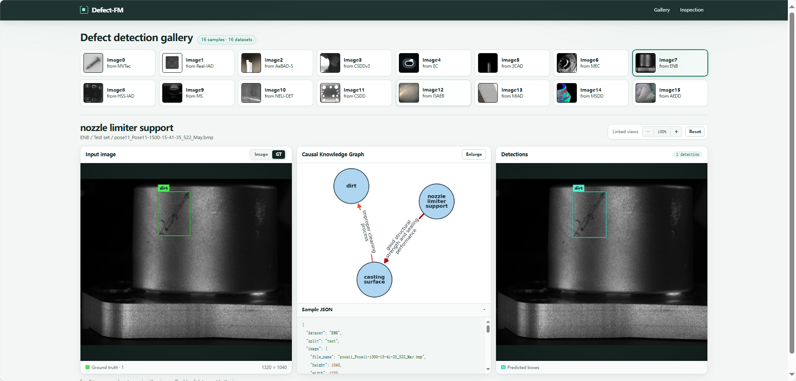

# Defect-FM


<p align="center">
  <b>Defect-FM: A Hierarchical Causal Knowledge-Enhanced Foundation Model for Full-View Defect Detection</b>
</p>

<p align="center">
 <a href="#Overview">Overview</a> |
  <a href="#Installation">Installation</a> |
  <a href="#Datasets">Datasets</a> |
  <a href="#Checkpoints">Checkpoints</a> |
  <a href="#Demo">Demo</a> |
  <a href="#Training">Training</a> |
  <a href="#Evaluation">Evaluation</a>
</p>

## Overview

We propose Defect-FM, a foundation model for full-view defect detection that embeds the hierarchical causal knowledge underlying defect emergence. This causal integration serves as a unifying logical bridge between diverse component geometries and their defect distributions, enabling effective cross-domain reasoning. 

## Installation

### Step 1: Defect-FM

```bash
conda create -n defect_fm python=3.10 -y
conda activate defect_fm
cd /path/to/Defect-FM

pip install torch==2.7.0 torchvision==0.22.0 --index-url https://download.pytorch.org/whl/cu128
pip install -r requirements.txt
pip install --no-build-isolation -e ./detectron2
pip install --no-build-isolation -e .
export PYTHONPATH="$PWD:$PWD/detectron2:${PYTHONPATH:-}"
```

Use a compatible NVIDIA driver, CUDA toolkit, and C++ compiler to build the CUDA extensions.
Place `label_embedding_basedatasets_on/`, `graph_basedatasets_on/`, and `weights/`
inside the repository root. See [dataset preparation](datasets/README.md) for annotation formats and paths.

### Step 2: HCKG

Install **HCKG (Hierarchical Causal Knowledge Graph)** in a separate environment:

```bash
conda create -n hckg python=3.10 -y
conda activate hckg
cd /path/to/Defect-FM/HCKG

pip install torch==2.1.1 torchvision==0.16.1 torchaudio==2.1.1
pip install -r requirements.txt
export HCKG_CLIP_CKPT=/path/to/open_clip_pytorch_model.bin
```

See [HCKG instructions](HCKG/README.md) for graph preparation, Graph Learning, and evaluation.

## Datasets

| Dataset | Download / access |
| :--- | :--- |
| 3CAD | [Project and download links](https://github.com/ShuCvlab/3CAD) |
| AeBAD-S | [Google Drive](https://drive.google.com/file/d/14wkZAFFeudlg0NMFLsiGwS0E593b-lNo/view?usp=share_link) — use the AeBAD_S subset |
| AEDD | [Select Dataset](https://www.selectdataset.com/dataset/a04e103aefb6cbd514e8c59e0218e302/aero-engine-defect-dataset) |
| CSDD | [Official project](https://github.com/Kerio99/CSDD) — request access from the dataset authors |
| CSDDv3 | [CSDD project](https://github.com/Kerio99/CSDD) — separate v3 download link not confirmed |
| HSS-IAD | [Google Drive](https://drive.google.com/file/d/13lBfOodsfkkQhX7PJ7kT8qc2KuHqwD4L/view?usp=sharing) |
| ISAEB (AEBIS) | [Project Dataset directory](https://github.com/Newbiejy/EGCIENet_In-service-blade-defect-detection) |
| MIAD (Wind Turbine) | [Google Drive](https://drive.google.com/file/d/1R1Dt3dDvjYHt3Iz4fbk17rfzsw0FQdHo/view?usp=share_link) |
| MPDD | [Official download page](https://github.com/stepanje/MPDD) |
| MSDD | [Paper and data-access information](https://doi.org/10.1038/s41597-025-04454-6) |
| MVTec AD | [Official download page](https://www.mvtec.com/company/research/datasets/mvtec-ad) |
| NEU-DET | [Official dataset page](https://faculty.neu.edu.cn/songkechen/zh_CN/zhym/263269/) |
| Real-IAD | [Hugging Face](https://huggingface.co/datasets/Real-IAD/Real-IAD) |

Links follow the supplied dataset list. Project and paper pages may require additional access steps;
confirm the dataset version before reproducing experiments.

## Checkpoints

Download the following files from the shared Google Drive folder and place them in
`weights/best_checkpoints/`. Each link opens the same folder; select the listed filename.

The joint-model demo uses `weights/model_best.pth`.

## Demo

<p align="center">
  <a href="https://xuefeng-ni.github.io/Defect-FM/">
    
  </a>
</p>

```bash
conda activate defect_fm
cd /path/to/Defect-FM
python demo/demo_defect_fm.py --weights weights/model_best.pth
```

The example image is `datasets/examples/demo.png`. Results are saved in `outputs/demo/`.
See [demo options](demo/README.md) for resource paths, device selection, and thresholds.

## Training

Prepare the dataset annotations, text embeddings, graph resources, and
`weights/model_pretrained.pth` before training. Update data and resource paths
as described in [dataset preparation](datasets/README.md).

```bash
conda activate defect_fm
cd /path/to/Defect-FM

# Single-dataset training (MPDD)
GPU_IDS=0,1 bash scripts/train_defect_fm.sh

# Joint training on 11 datasets
GPU_IDS=0,1 bash scripts/train_defect_fm_11datasets.sh
```

Both scripts use two GPUs. Training settings are defined in
[config_defect_fm.py](projects/deformable_detr/configs/config_defect_fm.py)
for MPDD and
[config_defect_fm_11datasets.py](projects/deformable_detr/configs/config_defect_fm_11datasets.py)
for joint training.

## Evaluation

Run AP50, instance-level F1 (B-F1), and image-level F1 (I-F1) evaluation on MPDD:

```bash
conda activate defect_fm
cd /path/to/Defect-FM
export PYTHONPATH="$PWD:$PWD/detectron2:${PYTHONPATH:-}"

python tools/eval_3cad_ap50_f1.py \
  --config projects/deformable_detr/configs/MPDD_finetune.py \
  --weights weights/best_checkpoints/model_MPDD_finetune.pth \
  --test-json datasets/merged_extra_fields/MPDD/test.json \
  --test-root /path/to/MPDD_COCO/images/test \
  --defect-vocab label_embedding_basedatasets_on/OpenCLIP_ViT-H-14_defect/MPDD_vocab.json \
  --dataset-name MPDD \
  --model-dataset-name coco_2017_test_group1 \
  --output-dir outputs/eval/MPDD
```

The evaluator supports other datasets despite its historical filename. Replace the
configuration, checkpoint, annotations, image root, and vocabulary with matching resources.
B-F1 and I-F1 thresholds are optimized separately on the supplied evaluation split.
For independent test reporting, select thresholds on a separate validation split.
See [evaluation tools](tools/README.md) for joint-model and saved-prediction evaluation.

